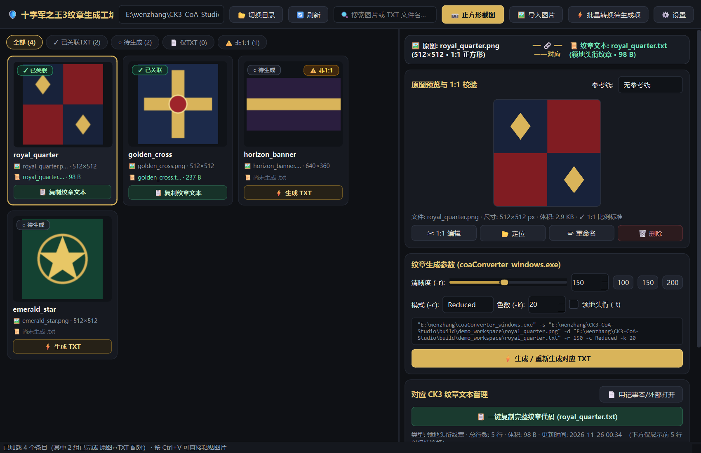
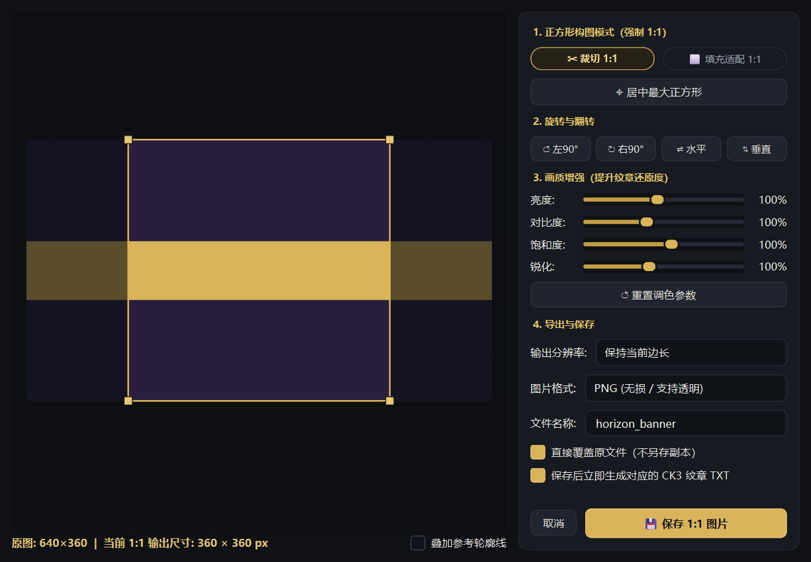

# 十字军之王3纹章生成工坊 (CK3 CoA Studio)

[](LICENSE)
[]()
[]()

一款专为 **《十字军之王 III》(Crusader Kings III / CK3)** 玩家与 Mod 创作者打造的现代桌面工作台，围绕 `coaConverter_windows.exe` 构建，打通 **「1:1 正方形截图 / 图片编辑 → 参数化生成纹章代码 → 原图与 TXT 一一对应管理 → 一键复制粘入游戏」** 完整工作流。

> **English Summary**: A clean Windows desktop studio for Crusader Kings III (CK3) Coat of Arms conversion (`coaConverter_windows.exe`). Features strict 1:1 square screen capture, a built-in 1:1 square image editor (crop, smart border pad, rotate, color/sharpness enhancement), paired Image ↔ CoA `.txt` gallery management, and lag-free one-click clipboard copying even for 70,000+ line CoA scripts.

---

## 界面预览

### 主工作台：原图 ↔ 纹章文本一一对应管理


### 内置 1:1 正方形图片编辑器（裁切 / 填充 / 画质增强）


---

## 核心特性

- **原图与纹章文本一一对应，再也不怕找错文件**
  - 自动扫描工作目录，将每张图片（如 `royal_quarter.png`）与其对应的纹章脚本（`royal_quarter.txt`）成对关联展示。
  - 卡片与详情页双锚点清晰标识 **「✓ 已关联」**、**「○ 待生成」**、**「📄 仅TXT」** 与 **「⚠ 非1:1」** 状态。
  - 支持 **同步重命名**（同时改原图与 `.txt`）以及安全 **移入 Windows 回收站**。
- **7 万行大体积 CK3 纹章 TXT 零卡顿复制**
  - CK3 高清转换后的 `.txt` 常达 1MB+（数万行代码），软件采用轻量头部分析（自动识别家族纹章 `coa_rd_dynasty` / 领地头衔 `coa_title`），仅预览前 40 行，点击 **「📋 一键复制完整纹章代码」** 即可秒速写入剪贴板，直接粘入游戏使用。
- **强制 1:1 正方形截图工具（`Ctrl+Shift+A`）**
  - 自动隐藏主窗口防遮挡，全屏拖拽框选自动锁定 `1:1` 正方形。
  - 内置 **3× 像素放大镜**、8 个控制点等比缩放与方向键 1px 微调，对齐像素边缘更轻松。
- **强制 1:1 正方形图片编辑器**
  - **裁切 1:1（Crop）**：自由拖拽与缩放正方形裁切框。
  - **填充适配 1:1（Pad）**：不想裁掉横图/竖图边缘时，居中放入正方形画布并支持 **边缘自动取色 / 透明底(PNG) / 纯黑 / 纯白 / 自定义颜色** 填充。
  - **几何与画质增强**：90° 旋转、水平/垂直翻转、亮度/对比度/饱和度/锐化实时调节，支持导出 `256×256`、`512×512`、`1024×1024` 并保存后自动生成 TXT。
- **完整支持 `coaConverter_windows.exe` CLI 参数**
  - 可视化调节 `-r`（清晰度，默认 `150`）、`-c`（色彩模式 `Reduced` / `Full` / `Vanilla`）、`-k`（颜色上限，默认 `20`）与 `-t`（领地头衔纹章）。
  - 支持 **批量转换待生成项**、**拖拽导入图片** 与 **`Ctrl+V` 直接粘贴剪贴板图片**。

---

## 快速开始

### 1. 下载运行（Windows）
前往本仓库的 **[Releases](../../releases)** 页面下载：
- **安装版**：`CK3-CoA-Studio-Setup-v1.0.0.exe`（图形化安装向导，自动创建桌面/开始菜单快捷方式）
- **便携版**：`CK3-CoA-Studio-v1.0.0-win64-portable.zip`（解压即用）

> **关于转换器 `coaConverter_windows.exe`**：
> 本仓库不包含第三方转换器二进制文件。请将您自己的 `coaConverter_windows.exe` 放在与本软件同级目录、上级目录或工作目录中（软件会自动探测识别），也可在软件右上角 **「⚙ 设置」** 中手动指定路径。

### 2. 从源码运行
环境要求：Windows 10/11，Python 3.10+
```bash
git clone <your-repo-url>
cd CK3-CoA-Studio
pip install -r requirements.txt
python src/main.py
```

### 3. 本地打包生成便携版与安装向导
```powershell
powershell -ExecutionPolicy Bypass -File packaging/build_release.ps1
```
构建产物将输出至 `release/` 目录。

---

## 快捷键一览

| 快捷键 | 功能 |
| :--- | :--- |
| `Ctrl + Shift + A` | 启动 1:1 正方形屏幕截图 |
| `Ctrl + V` | 直接将剪贴板中的图片送入 1:1 编辑器 |
| `F5` | 刷新当前工作目录配对状态 |

---

## 开源协议

本项目基于 [MIT License](LICENSE) 开源，仅供个人学习、游戏辅助与合法合规的创意用途。
