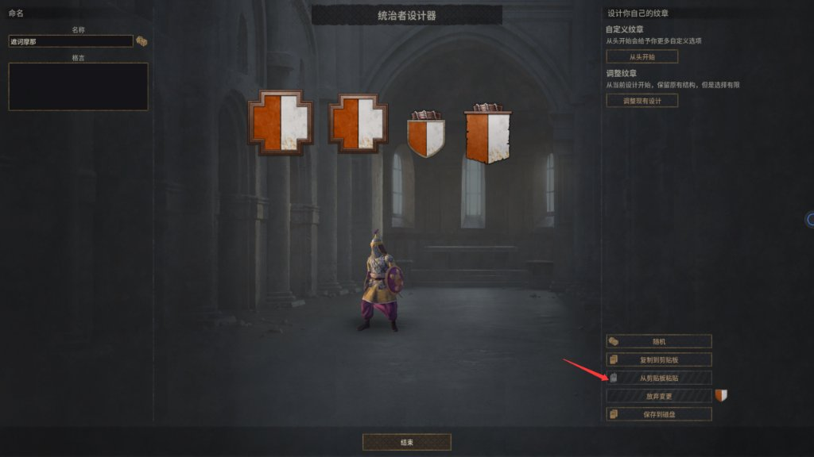
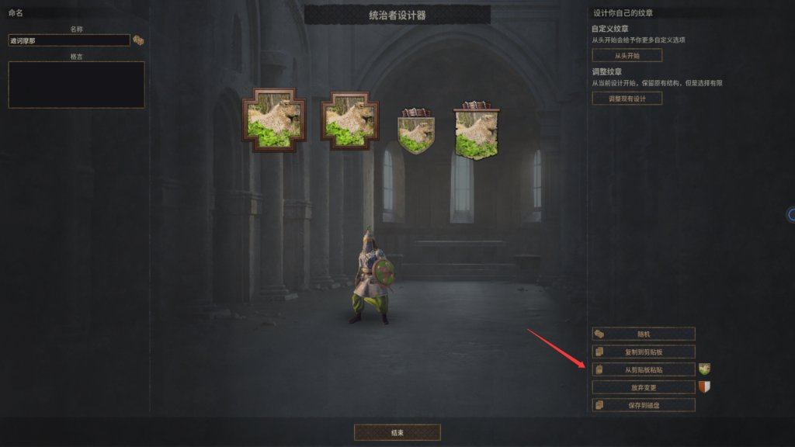
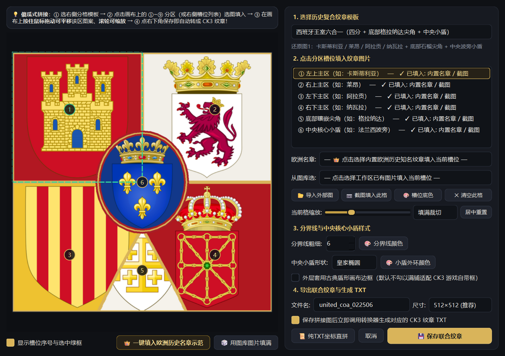
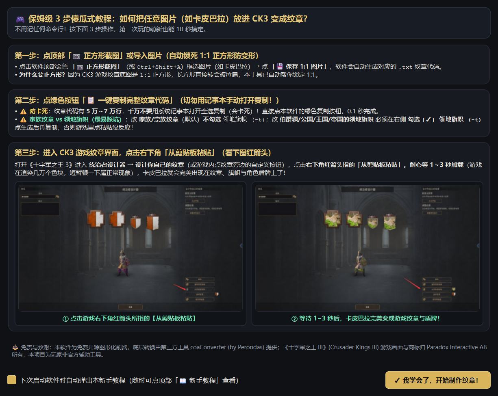

# 十字军之王3纹章生成工坊 (CK3 CoA Studio) — 图片转纹章 & 多纹章拼接合成器

[](LICENSE)
[]()
[]()

一款专为 **《十字军之王3 / 王国风云3》(Crusader Kings III / CK3)** 玩家与 Mod 创作者打造的现代桌面工作台，围绕 `coaConverter_windows.exe` 构建，打通 **「1:1 正方形截图 / 图片编辑 → 多纹章四分/六合一/九区复合拼接 → 参数化生成纹章代码 → 原图与 TXT 一一对应管理 → 一键复制粘贴入游戏」** 完整工作流。

> **English Summary**: **CK3 CoA Studio** is a modern Windows GUI for **Crusader Kings III (CK3) Coat of Arms conversion** (`coaConverter_windows.exe` frontend) and **Multi-CoA Heraldic Composition (Quartering / Escutcheon / Spanish 6-in-1 / Hanover 3-way / Savoy 9-in-1)**. Features strict 1:1 square screen capture, a built-in 1:1 square image editor (crop, smart border pad, rotate, color/sharpness enhancement), paired Image ↔ CoA `.txt` gallery management, and lag-free one-click clipboard copying even for 70,000+ line CoA scripts.

---

## 🎮 保姆级傻瓜式教程：3 步把任意图片（如卡皮巴拉）变成游戏纹章

很多新手玩家不知道怎么把图片放进游戏里，或者经常遇到「图片被拉扁」「记事本打开几十兆 TXT 直接卡死」「找不着哪张图对应哪个 TXT」的问题。用本工坊只需 **3 步**：

### 第一步：在软件里截图或导入图片（自动锁死 1:1 正方形）
1. 打开 **十字军之王3纹章生成工坊**（首次使用请确保已关联 `coaConverter_windows.exe`，详见下方[安装说明](#快速开始)）。
2. 点击顶部金色按钮 **「📷 正方形截图」**（或按快捷键 `Ctrl + Shift + A`），在屏幕上框选你喜欢的图片（比如一只**卡皮巴拉**）。
   - *为什么要正方形？因为 CK3 游戏里的纹章画布是严格的 `1:1` 正方形，长方形图片直接转进游戏会被强行拉扁！本工具会自动帮你锁定为正方形。*
3. 在弹出的编辑器里点击右下角 **「💾 保存 1:1 图片」**（默认勾选了「保存后立即生成对应的 CK3 纹章 TXT」），等待几秒即可生成完毕。

### 第二步：点击绿色按钮「一键复制纹章代码」
- 生成完成后，直接点击卡片上的 **「📋 复制纹章文本」** 或右侧绿色的 **「📋 一键复制完整纹章代码」** 按钮。
- ⚠️ **新手切记**：转换出来的纹章代码通常有 **5 万～7 万行**，**千万不要**用电脑自带的记事本打开去手动 `Ctrl+A` 复制（记事本会直接卡死）！直接点软件里的绿色复制按钮，0.1 秒即可复制完成。

### 第三步：进入 CK3 游戏，点击右下角「从剪贴板粘贴」
1. 打开《十字军之王 3》，在 **统治者设计器 → 设计你自己的纹章**（或游戏进行中点家族/头衔纹章旁的「自定义纹章」按钮）。
2. 点击游戏画面右下角的 **「📋 从剪贴板粘贴」**（如下图红箭头所指位置）：



3. **耐心等游戏反应 1～3 秒**（因为游戏正在加载几万个像素色块，短暂卡顿一下是完全正常的，不要乱点鼠标），你的卡皮巴拉就会原汁原味地出现在游戏纹章、家族旗帜和角色的盾牌上了！最后点击下方 **「结束」** 即可：



---

## ❓ 新手常见问题排查（必看）

- **问：为什么我在游戏里点「从剪贴板粘贴」没反应，或者提示无法粘贴？**
  - **原因 1**：你忘了先在软件里点绿色的 **「📋 一键复制完整纹章代码」** 按钮。
  - **原因 2（最常见）**：**家族纹章**和**领地头衔纹章**格式不同！
    - 如果你是在改 **家族 / 宗族纹章**（默认）：软件右侧 **不要勾选** `领地头衔 (-t)`。
    - 如果你是在改 **伯爵领 / 公国 / 王国 / 帝国的领地旗帜**：必须在软件右侧 **勾选 `[✓] 领地头衔 (-t)`**，然后点「⚡ 生成 / 重新生成对应 TXT」，再点复制去游戏里粘贴！
- **问：粘贴进游戏后觉得有点糊，或者游戏太卡怎么办？**
  - 软件右侧可以调节 **清晰度 (`-r`)**：
    - 默认 `150` 兼顾高画质与流畅度；
    - 如果想要极致清晰可以调到 `180`～`200`（代码行数会更多，粘贴时读条更久）；
    - 如果电脑配置较低或觉得卡，可以调低到 `100`～`120` 重新生成。

---

## 🖥️ 软件界面预览

### 主工作台：原图 ↔ 纹章文本一一对应管理
每一张原图和它生成的 `.txt` 纹章文件自动配对绑定，再也不会忘掉哪个 `.txt` 是哪张图转出来的：


### 🧩 多纹章拼接工坊（西班牙王室六合一 / 汉诺威三分 / 帝国九区大复合 / 四分+中央小盾）
无需手动画图对齐！内置 6 种经典历史复合纹章模板（完美还原**卡斯蒂利亚+莱昂+阿拉贡+纳瓦拉+底部格拉纳达尖角+中央法兰西波旁小盾**六合一、**汉诺威三分+小盾**、**萨伏依/帝国九区复合**、**经典四分+中央小盾**、**左右联姻二分**）。支持从图库一键点选或直接截图填入任意分区，在画布上鼠标拖拽平移、滚轮独立缩放每个分区，支持自定义鎏金分界线与中央小盾形状/外环色，一键导出并生成 CK3 纹章代码（同时支持已有 `.txt` 纹章代码直接按坐标缩放合并）：


### 内置 1:1 正方形图片编辑器（裁切 / 留白填充 / 画质增强）
支持自由裁切 1:1，或者不裁切直接自动取边缘色填充为 1:1 正方形，还支持锐化与对比度增强，让纹章进游戏更清晰：


### 软件内置「新手保姆级 3 步图文教程」（首次打开自动弹出，随时可查）
软件内部自带离线实机图文指引（顶部点击「📖 新手教程」或复制按钮下方的「📖 看红箭头图解」即可弹出），彻底解决新手不会用的问题：


---

## ✨ 核心特性

- **原图与纹章文本一一对应，告别文件混乱**
  - 自动扫描工作目录，将每张图片（如 `royal_quarter.png`）与其对应的纹章脚本（`royal_quarter.txt`）成对关联展示。
  - 清晰标识 **「✓ 已关联」**、**「○ 待生成」**、**「📄 仅TXT」** 与 **「⚠ 非1:1」** 状态。
  - 支持 **同步重命名**（改一个名字，原图与 `.txt` 一起改）以及安全 **移入 Windows 回收站**。
- **🔮 纹章 TXT 反向还原生成图片（图片 ⇄ TXT 双向互转）**
  - **孤立 TXT 自动显形**：目录中只有 `.txt` 没有原图的文件（或别人分享的 `.txt`），在左侧卡片与右侧预览区会**自动在 20 毫秒内反向渲染出纹章画面**，一眼看出这串代码是什么图案！
  - **剪贴板代码/TXT 一键转 PNG**：点击右侧 **「🔮 TXT反推生成图片」**（或复制别人分享的纹章代码后在主界面按 `Ctrl+V`），即可将数万行纹章代码反向还原并保存为 `512×512` / `1024×1024` 高清 `1:1` PNG 图片，并自动完成 `原图 ↔ TXT` 配对。
- **7 万行大体积 CK3 纹章 TXT 零卡顿复制**
  - 采用轻量头部分析（自动识别家族纹章 `coa_rd_dynasty` / 领地头衔 `coa_title`），仅预览前 40 行保持界面丝滑，点击按钮即可秒速复制全文到剪贴板。
- **强制 1:1 正方形截图工具（`Ctrl+Shift+A`）**
  - 自动隐藏主窗口防遮挡，全屏拖拽框选自动锁定 `1:1` 正方形，内置 **3× 像素放大镜**、8 点等比缩放与方向键 1px 微调。
- **强制 1:1 正方形图片编辑器**
  - **裁切 1:1（Crop）** 与 **填充适配 1:1（Pad：边缘自动取色 / 透明底 / 纯黑 / 纯白 / 自定义颜色）** 双模式。
  - 支持 90° 旋转、水平/垂直翻转、亮度/对比度/饱和度/锐化实时调节，支持导出 `256×256`、`512×512`、`1024×1024`。
- **完整支持 `coaConverter_windows.exe` 全部参数**
  - 可视化调节 `-r`（清晰度，默认 `150`）、`-c`（色彩模式 `Reduced` / `Full` / `Vanilla`）、`-k`（颜色上限，默认 `20`）与 `-t`（领地头衔纹章）。
  - 支持 **批量转换待生成项**、**拖拽导入图片** 与 **`Ctrl+V` 直接粘贴剪贴板图片**。

---

## 🚀 快速开始

### 1. 下载安装（Windows 傻瓜包）
前往本仓库右侧的 **[Releases](../../releases)** 页面下载：
- **安装版（推荐新手）**：`CK3-CoA-Studio-Setup-v1.0.0.exe`（双击按提示安装，自动在桌面创建「十字军之王3纹章生成工坊」快捷方式）
- **免安装绿色便携版**：`CK3-CoA-Studio-v1.0.0-win64-portable.zip`（解压后双击里面的 `CK3-CoA-Studio.exe` 即可运行）

> **⚠️ 重要：配合 `coaConverter_windows.exe` 使用**
> 本软件是 `coaConverter_windows.exe` 的图形化管理与截图修图工作台（仓库本身不包含第三方转换器本体）：
> - 把你下载的 `coaConverter_windows.exe` 放在你存放纹章图片的文件夹里（或者放在本软件同级/上级目录），软件打开后会**自动识别**；
> - 如果左下角提示未检测到转换器，点击软件右上角 **「⚙ 设置」 → 「浏览...」** 选中你的 `coaConverter_windows.exe` 即可一劳永逸。

### 2. 从源码运行（开发者）
环境要求：Windows 10/11，Python 3.10+
```bash
git clone https://github.com/fahua408/CK3-CoA-Studio.git
cd CK3-CoA-Studio
pip install -r requirements.txt
python src/main.py
```

### 3. 本地打包生成便携版与安装向导
```powershell
powershell -ExecutionPolicy Bypass -File packaging/build_release.ps1
```

---

## ⌨️ 快捷键一览

| 快捷键 | 功能 |
| :--- | :--- |
| `Ctrl + Shift + A` | 启动 1:1 正方形屏幕截图 |
| `Ctrl + V` | 直接将剪贴板中的图片送入 1:1 编辑器 |
| `F5` | 刷新当前工作目录配对状态 |

---

## 🔗 同作者开源工具推荐 (Related Projects by Author)

- 👑 **[CK3-DirectLAN — 《十字军之王3 / 王国风云3》私人联机 P2P 高速直连助手](https://github.com/fahua408/CK3-DirectLAN)**
  自建虚拟局域网 P2P 高速直连联机工具，解决 CK3 多人联机掉线、不同步（Desync）、高延迟与服务器卡顿问题，实测 4～5 速稳定同步。
- 🖥️ **[dsh-pet-on-screen — 大肥鱼桌宠钛坦屏 / TCOMAS LG700 水冷副屏双桌宠协同投放控制台](https://github.com/fahua408/dsh-pet-on-screen)**
  基于 DirectIO USB HID 管道的 640×480 水冷副屏桌宠（DeepSeek 蓝毛女仆 `dsh-pet` & Coopanion 大肥鱼）30FPS 零拷贝投放与硬件壁纸刷写工具。

---

## 开源协议与免责致谢 (License, Credits & Disclaimer)

- **开源协议**：本项目源码基于 [MIT License](LICENSE) 开源，免费提供给玩家与 Mod 创作者学习与个人非商业辅助使用。
- **第三方转换器致谢**：纹章底层命令行转换由第三方开源工具 `coaConverter` (`coaConverter_windows.exe`, Author: **Perondas**) 提供。本仓库仅提供图形化管理、1:1 截图与图片编辑前端，**不打包、不分发** `coaConverter_windows.exe` 二进制本体，请用户自行获取并配置。
- **游戏商标与版权声明**：《十字军之王 III》(Crusader Kings III) 及其游戏内界面、徽章框架与相关商标版权均归 **Paradox Interactive AB** 所有。本项目为玩家自制的非官方辅助工具，与 Paradox Interactive 无任何隶属、合作或官方授权关系。
- **素材合规提示**：本工具所有图片裁切与文本转换均在用户本地电脑离线完成，请确保所转换的图片素材符合所在地法律法规与社区规范。

---

<details>
<summary>🔍 搜索关键词索引 (Search Keywords & Tags for Indexing)</summary>

`十字军之王3纹章` · `十字军之王3图片转纹章` · `十字军之王3自定义纹章代码` · `十字军之王3纹章生成器` · `十字军之王3纹章拼接` · `十字军之王3四分纹章` · `十字军之王3联统纹章` · `王国风云3纹章工具` · `王國風雲3圖片轉紋章` · `CK3纹章转换器` · `coaConverter_windows.exe使用教程` · `coaConverter图形界面` · `coaConverter GUI` · `CK3 Coat of Arms Generator` · `CK3 Image to Coat of Arms Converter` · `CK3 Custom Coat of Arms Paste Clipboard` · `CK3 Quartered Coat of Arms Merger` · `Crusader Kings 3 Heraldry Tool` · `Crusader Kings III Modding Tools`

</details>
